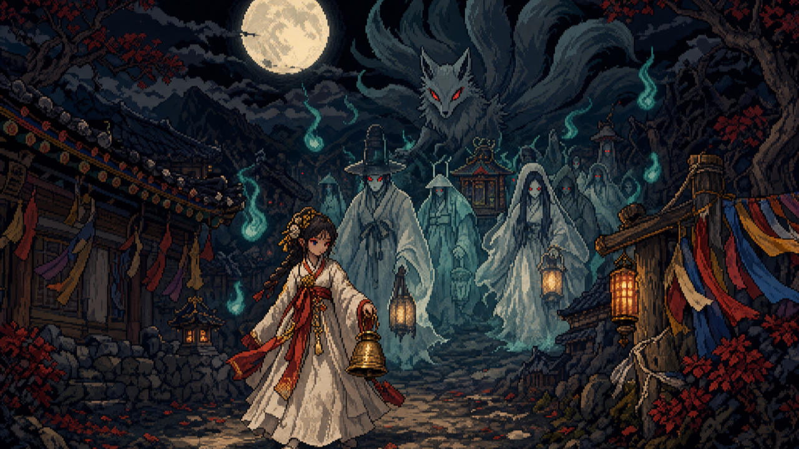
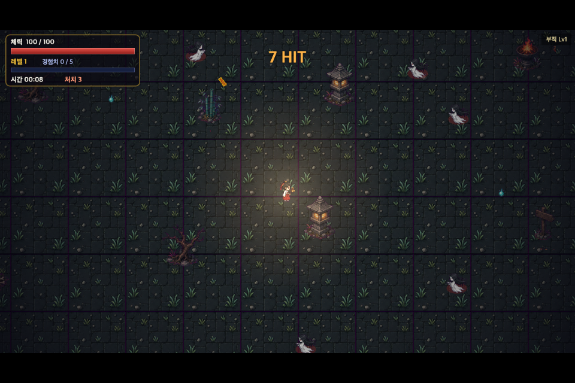

# 백귀야행: 도깨비 서바이버스

> **AI 팀이 2주 동안 만든 첫 게임**(실험 기록). 완성작이 아니라, AI가 기획부터 출시 준비까지 혼자 해 보면
> 어디까지 되고 어디서 막히는지를 그대로 남긴 결과물입니다.

**▶ 브라우저에서 바로 해 보기:** https://songyonggyu4006.github.io/baekgwi-yahaeng/

무당 '해랑'이 되어, 달이 뜬 밤 마을로 몰려오는 한국 설화 속 귀신들을 버티는 10분짜리 서바이버스류 게임입니다.

무기(부적·부채·방울…)는 저절로 공격하고, 플레이어는 움직이면서 레벨업할 때 무기와 소품을 고릅니다.

| 조작 | |
|---|---|
| 이동 | 방향키 / WASD |
| 레벨업 카드 고르기 | 1 / 2 / 3 (Enter = 1번) |
| 일시정지 | P |
| 소리 켜고 끄기 | M |

설치할 것은 없습니다. 파일을 받아서 실행하려면 이 폴더에서 정적 서버(예: `python3 -m http.server`)를 띄우고 `index.html` 을 엽니다.
ES 모듈이라 `file://` 로 직접 열면 동작하지 않습니다.

---

## 어떻게 만들었나

2026년 10월 25일부터 11월 9일까지 자동 공정으로 만들었습니다. 사람은 코드를 쓰지 않았습니다. 코드는 대부분 아래 공정이 썼고, 공정이 끝내 못 찾은 큰 버그 두 번(새 무기가 공격하지 않음, 무기 그리기 인자 오류)만 공정을 관리하는 AI(Claude)가 직접 고쳤습니다.

| 역할 | 맡은 것 |
|---|---|
| 기획·설계 | 외부 AI가 설계서(DESIGN)와 단계 18개, 단계마다 통과해야 할 자동 점검을 작성 |
| 프로그래머 | 이 맥에서 도는 로컬 모델(Qwen3.8-27B)이 단계마다 코드를 작성. 막히면 여러 전략을 동시에 시도해 가장 많이 통과한 쪽을 채택 |
| 아트 디렉터·아티스트 | 외부 AI가 그림 방향을 정하고, 이미지 생성 모델로 캐릭터·적·동작 그림을 만든 뒤 코드가 배경을 지우고 잘라 넣음(그림 비용 약 2.63달러) |
| 사운드 | 효과음과 배경음은 모두 Web Audio 로 코드에서 합성(녹음 파일 없음) |
| QA | 헤드리스 브라우저가 게임을 직접 플레이하며 화면을 찍고, 점검 항목(로딩, 이동, 프레임, 효과가 실제로 들어가는지 등)을 채점 |
| 사람 | 중간 결과를 보고 의견만 전달(예: "레벨업 창이 이상하고 화면이 너무 어둡다", "새 무기를 먹어도 안 써진다", "귀신이 거꾸로 다가온다") |

### 단계별 기록

| # | 단계 | 시도 |
|---|---|---|
| 1 | 뼈대와 이동 | 1 |
| 2 | 도트 그림(아티스트) | 1 |
| 3 | 효과음·배경음(사운드) | 1 |
| 4 | 적 생성·추격·피격 | 2 |
| 5 | 첫 무기 부적과 데미지 계산 | 1 |
| 6 | 그림 파일로 교체(이미지 생성) | 1 |
| 7 | 걷기·공격·피격 동작과 손맛 | 2 |
| 8 | 경험치와 레벨업 선택 | 2 |
| 9 | 1차 완성판(처음부터 끝까지 한 판) | 1 |
| 10 | 무기 7종 추가 | 3 |
| 11 | 패시브 소품과 강화 규칙 | 2 |
| 12 | 무기 진화 | 2 |
| 13 | 적 7종과 웨이브 | 1 |
| 14 | 다듬기(타격감·소리·화면·밸런스) | 1 |
| 15 | 긴급 수정: 레벨업 창·화면 밝기·글자 겹침 | 3 |
| 16 | 정예·보스와 승리 조건 | 1 |
| 17 | 아트 3차: 배경·효과·기술 아이콘·HUD | 1 |
| 18 | 출시 준비(제목 화면·조작 안내·최고 기록) | 1 |

### 잘 된 것
- 18단계 모두 자동 점검을 통과했고, 처음부터 끝까지 한 판이 돌아갑니다.
- 단계마다 실제 브라우저에서 점검했기 때문에 "코드는 있는데 화면에서 안 되는" 문제를 꽤 많이 잡았습니다.

### 안 된 것 (솔직하게)
- **재미와 완성도는 판매할 수준이 아닙니다.** 점검을 통과하는 것과 재미있는 것은 달랐습니다.
- 사람이 직접 해 봐야 보이는 문제가 많았습니다. 새로 얻은 무기 7종이 실제로는 공격하지 않던 버그는 점검이 "무기가 있다"만 확인하고 "피해를 준다"는 확인하지 않아서, 사람이 직접 해 보고 알려 줄 때까지 남아 있었습니다(그 뒤 고침).
- 한 단계의 수정이 앞에서 만든 그림을 덮어쓰는 일이 여러 번 있었고, 그림 원본을 보호하는 장치를 나중에 추가했습니다.
- 이 경험으로 다음 게임부터는 "효과가 실제로 일어나는지" 점검, 같은 판을 여러 번 돌리는 밸런스 점검, AI가 직접 플레이해 보고 고칠 점을 찾는 단계를 공정에 넣었습니다.

---

## 쓴 것

- 코드: 바닐라 JavaScript(ES 모듈), Canvas 2D, Web Audio. 외부 라이브러리 없음.
- 그림: OpenAI 이미지 생성 모델로 만든 이미지(이 프로젝트용으로 새로 생성).
- 글꼴: 브라우저 기본 글꼴.

## 라이선스

[MIT](LICENSE) — 코드와 그림 모두 자유롭게 써도 됩니다.

---

### English (short)

**Baekgwi Yahaeng: Dokkaebi Survivors** is a small browser survivors-like game set in a Korean folklore night village.
It is an *experiment record*: an automated AI pipeline (a local Qwen3.8-27B model as the programmer, outside AI models for design and art,
headless-browser QA) built it over two weeks with no human-written code (two large bugs the pipeline missed were fixed by the supervising AI). It passes all 18 automated milestone checks, but it is honestly
not polished or fun enough to sell; the README above lists what worked and what did not. Arrow keys / WASD to move, 1–3 to pick upgrades, P to pause, M for sound.
Serve the folder with any static server and open `index.html`. MIT licensed.
